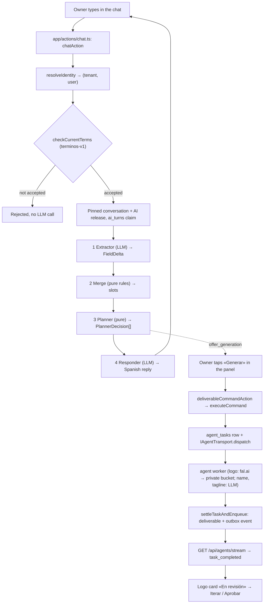

# CreaMype features

CreaMype is an AI-assisted brand-creation wizard for Peruvian micro and small businesses
(MYPEs). The owner chats in Spanish; the app collects the facts each sub-agent needs (business
name, style, colors…) and, when the owner taps a button, a sub-agent produces a deliverable (today
the logo, business-name candidates and tagline candidates). It is also a thesis project whose claim is **a deterministic decision layer over
LLM-extracted state**: LLMs only read the user's text and write the reply, while a pure,
table-tested planner decides what happens next.

This folder explains each main feature: what the user gets, how it works in the code, and the
rules that protect it. Every file follows the same shape (What it does · How it works · Key
rules · Decisions · Limits · See also). It points to code and records; it does not copy them.

## One user turn, end to end

No chat text can start a paid generation: generation starts only from the typed panel commands.

## Features

| Feature | What the user gets | Read |
|---|---|---|
| Chat turn | A Spanish conversation that collects the brief and asks only what is missing | [01-chat-turn.md](01-chat-turn.md) |
| Agents and transport | A logo, five business-name candidates and five taglines (from the approved name) generated from the brief; other agents are declared but not live | [02-agents-and-transport.md](02-agents-and-transport.md) |
| Deliverable lifecycle | Generar / Iterar / Aprobar / Reintentar / Cancelar buttons with clear states, failure recovery, and a «Potencialmente desactualizado» notice when a name or brief value the deliverable used changes | [03-deliverable-lifecycle.md](03-deliverable-lifecycle.md) |
| Live updates | «Generando» and the finished logo appear without reloading | [04-live-updates.md](04-live-updates.md) |
| Auth, tenancy and isolation | Sign-in through the organization; nobody sees another tenant's or member's data | [05-auth-tenancy-isolation.md](05-auth-tenancy-isolation.md) |
| Assets and storage | Generated logos kept privately and shown only to their owner | [06-assets-storage.md](06-assets-storage.md) |
| Conversations | The app reopens the latest conversation; «Mis conversaciones» switches between them | [07-conversations.md](07-conversations.md) |
| Consent | A terms screen that must be accepted before any AI work | [08-consent.md](08-consent.md) |
| AI configuration and model execution | Stable, versioned model behavior per conversation, with one approved fallback | [09-ai-configuration.md](09-ai-configuration.md) |
| Admin and platform operator | Platform console: organizations, operators, module rollouts, monthly metrics, audit trail; tenant admins manage their tenant's accounts | [10-admin-platform.md](10-admin-platform.md) |
| Operations | Health probes, safe deploy migrations, CI, and paid evals on request | [11-operations.md](11-operations.md) |
| Product brief | Chat and an editable panel write the same validated brief, with origin and missing preconditions shown | [12-product-brief.md](12-product-brief.md) |
| Usage limits | Budget and rate limits checked before every paid model or image call | [13-usage-limits.md](13-usage-limits.md) |
| Backup and restore | RPO/RTO targets, runbook and a scripted restore rehearsal | [14-backup-restore.md](14-backup-restore.md) |
| Trace and pilot metrics | A downloadable, ordered trace of each conversation; metadata-only views, monthly samples and pilot metrics for operators | [15-trace-and-metrics.md](15-trace-and-metrics.md) |

The wizard UI (`components/CreaMype.tsx`) still shows five steps (Nombre, Logo, Etiqueta, Web,
Marketing). Only the brief, the name, the tagline («Lema», in the name step) and the logo are wired
to the orchestrator; the other steps are not. The logo and the tagline need an approved name first
(KAN-35 dependency map).

## Other records

- Operations runbook: [`docs/operations.md`](../operations.md)
- Personal data and consent: [`docs/personal-data.md`](../personal-data.md)
- UI references: [`docs/ui/`](../ui/react-migration-baseline.md)
- Owner decisions: [`pipeline/decisions/README.md`](../../pipeline/decisions/README.md)
- Project overview: [`README.md`](../../README.md)
